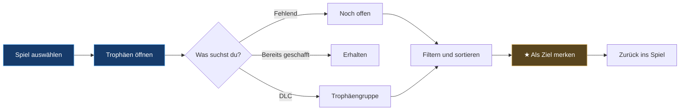
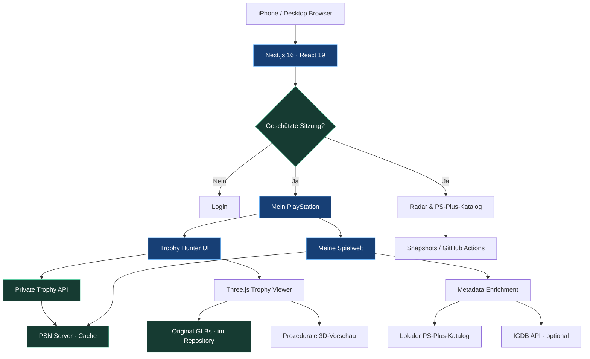

<div align="center">


### THE PLAYSTATION EXPERIENCE · REIMAGINED

**Deine Spiele. Deine Trophäen. Dein Radar. Ein privates Gaming-Cockpit.**

[](https://nextjs.org/)
[](https://react.dev/)
[](https://threejs.org/)
[](https://vercel.com/)
[](#-security--privacy)

[](https://github.com/westside0106/Ps5-Radar/actions/workflows/daily-catalog.yml)


<br/>

[**▶ PLAYSTATION-RADAR ÖFFNEN**](https://playstation-radar-private.vercel.app/mein-playstation)

[Features](#-mission-control) · [Trophäen](#-trophy-hunter) · [3D](#-3d-trophy-showcase) · [Spielwelt](#-meine-spielwelt) · [Setup](#-quick-start) · [Architektur](#-system-architecture) · [Roadmap](#-roadmap)

</div>

---

> [!IMPORTANT]
> **PRIVATE BUILD · KEINE ÖFFENTLICHE PSN-SITZUNG.** Dieses Projekt ist ein privates Fan-Dashboard. Der Zugriff auf persönliche PSN-Daten ist serverseitig geschützt. Zugangsdaten, Sitzungsschlüssel und Sony-Tokens gehören **ausschließlich** in geschützte Umgebungsvariablen – niemals in dieses Repository.

## ◈ MISSION CONTROL

<table>
<tr>
<td width="50%" valign="top">

### 01 / RADAR

**Gaming-Informationen, Angebote und Katalogbewegungen.**

- PlayStation-Radar und Angebotsübersichten
- Preisradar und verfügbare Snapshots
- Automatisierte Aktualisierungsworkflows
- Eigene Bereiche für PlayStation und Xbox

</td>
<td width="50%" valign="top">

### 02 / PS PLUS ATLAS

**Ein durchsuchbarer Katalog statt endloser Store-Seiten.**

- Essential · Extra · Premium / Klassiker
- Ubisoft+ Classics
- Suche, Plattform-, Genre-, Modus- und Perspektivfilter
- Veröffentlichungs- und weitere Sortierungen
- Cover-Fallbacks und bestätigte Metadaten

</td>
</tr>
<tr>
<td width="50%" valign="top">

### 03 / TROPHY HUNTER

**Vom Fortschrittsbalken zur gezielten Platin-Jagd.**

- PSN-Trophäenübersicht und Detailansicht
- Offene, erhaltene und alle Trophäen
- Rang-, Gruppen-, Text- und Sortierfilter
- Merkliste für persönliche Trophäenziele
- Interaktive 3D-Rangvorschau

</td>
<td width="50%" valign="top">

### 04 / MY PLAYSTATION

**Deine persönliche Spielewelt.**

- Zuletzt gespielte Titel und PSN-Spielzeit
- Individuelle Spieldetails
- IGDB-Genres, Modi, Perspektive und optionale Screenshots (bei Bedarf serverseitig nachgeladen)
- Historische Metacritic-/Nutzerwertungen und geschätzte Spieldauer/Platinzeit für 376 Titel (OliveOcelot, September 2026)
- Vergleichswerte strikt getrennt von echter PSN-Spielzeit; historische Listenstatus **nicht** als aktuelle PS-Plus-Verfügbarkeit behandeln
- Metadaten- und Cover-Lückenfilter
- Apps & Medien getrennt von Spielen

</td>
</tr>
</table>

## 🏆 TROPHY HUNTER

<div align="center">


</div>

Die **Trophäen-Zentrale** unter `/mein-playstation` ist auf die Frage optimiert: **Welche Trophäe fehlt mir – und was mache ich als Nächstes?**

| Capability | Umsetzung |
|:--|:--|
| **Progress Navigator** | Fortschrittsfilter 0–100 % und Schnellwahl |
| **Trophy Detail View** | Eigenständiges mobiles Dialogfenster statt Inline-Liste |
| **Hunt Modes** | Noch offen / Erhalten / Alle |
| **Advanced Filtering** | Trophäenrang, Gruppe, Textsuche und Sortierung |
| **DLC Groups** | Vollversion und Add-ons; Sony-Gruppennamen, sofern geliefert |
| **Hidden Trophies** | Verborgene Details auf Wunsch einzeln enthüllen |
| **Target List** | ☆ / ★ – Trophäen lokal als persönliche Ziele markieren |
| **Trophy Artwork** | Originale Einzel-Trophäenbilder, sofern von PSN geliefert |
| **Rarity** | Seltenheitsbasierte Sortierung, sofern Sony Werte bereitstellt |
| **Earned Data** | Freischaltungsdatum, sofern Sony es liefert |
| **3D Ranks** | In die Sammlungsübersicht integrierte, per Touch drehbare 3D-Trophäen |

> [!NOTE]
> Die Zielmarkierungen werden derzeit **im lokalen Browser-Speicher** gehalten. Sie sind keine PSN-Funktion und werden nicht automatisch zwischen Geräten synchronisiert. Die Detaildaten werden erst bei Bedarf vom Server abgerufen und kurz zwischengespeichert.

### Trophy-Hunt-Flow



## 💎 3D TROPHY SHOWCASE

<div align="center">

**INTERACTIVE · TOUCH-ROTATABLE · ON-DEMAND WEBGL**

`PLATINUM` · `GOLD` · `SILVER` · `BRONZE`

</div>

Das 3D-System basiert auf **Three.js** und ist in die zentrale Trophäensammlung eingebettet, statt die Detailansicht einzelner Spiele zu blockieren. Die vier Rangschalter wechseln das Modell; die Darstellung unterstützt Rotation per Finger. Für die vier Ränge existieren feste GLB-Pfade:

```text
public/
└── trophies/
    ├── platinum.glb
    ├── gold.glb
    ├── silver.glb
    ├── bronze.glb
    └── README.md
```

> [!NOTE]
> **Alle vier Original-GLBs sind jetzt im Repository vorhanden.** Der Viewer verwendet die Modelle unter `public/trophies/` und greift nur dann auf eine vereinfachte, prozedurale Three.js-Trophäe zurück, wenn ein Modell nicht erreichbar oder nicht ladbar ist. Die Darstellung auf einem echten iPhone muss noch im Praxistest geprüft werden.

**Rendering-Konzept**

- Lazy-Loading der 3D-Komponente; keine zusätzlichen WebGL-Viewer in den einzelnen Spielkarten
- Ein aktiver Viewer in der Trophäensammlung
- Touch-Rotation, automatische langsame Drehung, ResizeObserver
- Metalness-/Roughness-Materialien und gerichtete Beleuchtung
- Fallback, falls ein Originalmodell nicht erreichbar oder nicht ladbar ist
- Bereinigung von WebGL-Ressourcen beim Schließen

**Implementierung:** [`TrophyModel.jsx`](app/mein-playstation/TrophyModel.jsx) · [`public/trophies/README.md`](public/trophies/README.md)

## 🎮 MEINE SPIELWELT

**PSN-Spielaktivität trifft auf kuratierte Game-Metadaten.**

```text
MY PLAYSTATION
│
├── TROPHÄEN-ZENTRALE
│   ├── Fortschritt / Rang / Seltenheit
│   ├── Offene & erhaltene Erfolge
│   ├── DLC-Gruppen / Trophäenziele
│   └── 3D-Trophäenränge
│
└── MEINE SPIELWELT
    ├── Spiele
    │   ├── Zuletzt gespielt
    │   ├── Spielzeit
    │   ├── Cover & Screenshots
    │   ├── Genre / Spielmodus / Perspektive
    │   └── IGDB-Metadatenstatus
    └── Apps & Medien
```

### Metadata Intelligence

Der Server ordnet Titel **konservativ** zu: erst über den bestehenden PS-Plus-Katalog, optional zusätzlich über **IGDB**. Ein unklarer Treffer wird nicht stillschweigend einem anderen Spiel zugeordnet.

| Daten | Herkunft / Verhalten |
|:--|:--|
| Spielzeit, letzter Spieltag | PSN, soweit verfügbar |
| Cover und Spielbeschreibung | PSN / PS-Plus-Katalog / IGDB |
| Genre, Spielmodus, Perspektive | Bestätigte Metadaten |
| Screenshots, aggregierte Wertung | Optional IGDB |
| Fehlende Informationen | Werden gekennzeichnet, **nicht geschätzt** |

Mit **Alle Datenstände**, **Unvollständige Daten**, **Ohne IGDB** und **Ohne Cover** lassen sich Titel mit Nachbearbeitungsbedarf gezielt finden.

> [!NOTE]
> Sonys Liste zuletzt gespielter Titel ist **keine verifizierte vollständige Kaufbibliothek**. Metadaten- und Trophäenabdeckung hängen von den verfügbaren Sony-Endpunkten und den jeweiligen Datenquellen ab.

## 🗂️ PS PLUS CATALOG

Der Katalog bündelt bestätigte Einträge für **Essential, Extra, Premium/Klassiker und Ubisoft+ Classics**. Die Oberfläche bietet kombinierbare Filter, mobile Suche und Sortierungen. Katalogstände und Verfügbarkeit können sich ändern; maßgeblich bleiben die angezeigten Quellen und der jeweilige Erfassungsstand.

**Mobile-UX:** Suchfeld und Aktionsbuttons sind für schmale Bildschirme neu proportioniert. Die Anzahl gleichzeitig fixierter Leisten wurde reduziert, damit Spielecover nicht von der Navigation überdeckt werden.

## 🧠 SYSTEM ARCHITECTURE



**Technology stack**

| Layer | Technologie |
|:--|:--|
| Frontend | Next.js 16 · React 19 · JavaScript / JSX |
| Design | Responsive CSS · Mobile-first Dialoge · Touch |
| 3D | Three.js · WebGL · glTF/GLB |
| Game Data | PSN-Endpunkte · PS-Plus-Snapshots · optional IGDB |
| Hosting | Vercel |
| Automation | GitHub Actions |
| Testing | Node Test Runner · vorhandene Playwright-Skripte |

## 🔐 SECURITY & PRIVACY

| Environment Variable | Verwendung |
|:--|:--|
| `RADAR_PASSWORD` | Passwort der privaten Anwendung |
| `RADAR_SESSION_SECRET` | Geheimnis zur Signierung/Absicherung der Sitzung; mindestens 32 Zeichen |
| `PSN_NPSSO` | Privater Sony-Session-Token für PSN-Daten |
| `IGDB_CLIENT_ID` | Optionaler IGDB-Client |
| `IGDB_CLIENT_SECRET` | Optionales IGDB-Secret |

- **Keine Zugangsdaten im Frontend, in Commits oder Screenshots.**
- Die PSN-Anbindung arbeitet serverseitig und **read-only**.
- Persönliche PSN-IDs werden nicht zur IGDB-Titelsuche übertragen.
- Private API-Routen prüfen die Radar-Sitzung.
- Eine `robots.txt`-Sperre ersetzt **keine** Authentifizierung.
- PSN-Endpunkte sind **inoffiziell** und können sich ändern.

## ⚡ QUICK START

```bash
git clone https://github.com/westside0106/Ps5-Radar.git
cd Ps5-Radar
cp .env.example .env.local
npm ci
npm run dev
```

Öffne `http://localhost:3000`. Trage Geheimnisse ausschließlich in `.env.local` ein und committe diese Datei nicht.

<details>
<summary><strong>▶ Build, Checks und Wartung</strong></summary>

```bash
npm run build
npm run test:goal
npm run test:platform
npm run test:psn
npm run catalog:refresh
```

`npm run catalog:refresh` aktualisiert Daten und ist kein rein lesender Test. Ein erfolgreiches Deployment beweist nicht automatisch die Funktion aller Sony-Endpunkte oder die Bedienbarkeit auf einem konkreten iPhone.

</details>

<details>
<summary><strong>▶ Repository-Struktur</strong></summary>

| Pfad | Aufgabe |
|:--|:--|
| `app/mein-playstation/PlayStationHub.jsx` | Private PSN-Oberfläche, Trophäen-Zentrale, Spielwelt |
| `app/mein-playstation/TrophyModel.jsx` | Interaktiver Three.js-Viewer |
| `app/mein-playstation/style.css` | Responsive PlayStation-Hub-Gestaltung |
| `app/mein-playstation/api/trophies/` | Private Trophäen-Detailroute |
| `lib/psn-server.mjs` | PSN-Anbindung, Trophäen und Cache |
| `lib/psn-game-metadata.mjs` | Konservativer PSN-/IGDB-Abgleich |
| `app/ps-plus/` | PS-Plus-Katalog |
| `app/radar/` | Radar-Oberfläche |
| `data/` | Katalog- und Snapshot-Dateien |
| `.github/workflows/` | Datenaktualisierung |
| `scripts/` | Validierung, Import und Tests |

</details>

## 🛣️ ROADMAP

| Status | Meilenstein |
|:--:|:--|
| ✅ | Private PSN-Anbindung und Trophäenübersicht |
| ✅ | Trophy Hunter mit Suche, Filtern, Zielmarkierungen und DLC-Gruppen |
| ✅ | Eigene mobile Trophäen-Detailansicht |
| ✅ | Three.js-Viewer mit Touch-Rotation und prozeduralem 3D-Fallback |
| ⏳ | **Vier Original-GLB-Modelle in `public/trophies/` veröffentlichen** |
| ⏳ | Praxistest auf iPhone / Mobile Safari |
| ⏳ | PSN-DLC-Namen, Seltenheit und versteckte Trophäen an echten Daten validieren |
| ⏳ | Cover- und Metadatenlücken weiter schließen |
| ⏳ | Vollständigkeit der PSN-Kaufbibliothek gesondert verifizieren |
| ◇ | Persönliche Empfehlungen / PS-Plus-Bibliotheksabgleich |
| ◇ | PlayStation Wrapped / Jahresrückblick (nachrangig) |
| ◇ | Xbox-Achievements und tiefere Xbox-Integration (nachrangig) |

**Legende:** ✅ implementiert · ⏳ offen / zu verifizieren · ◇ vorgemerkt

---

## ⚖️ LEGAL & DATA NOTES

Dieses Projekt ist ein **unabhängiges, privates Fanprojekt** und **nicht mit Sony Interactive Entertainment verbunden**. PlayStation und zugehörige Marken gehören ihren jeweiligen Rechteinhabern. Datenqualität und Verfügbarkeit hängen von Sonys Schnittstellen, Berechtigungen, Quellenstand und Privatsphäre-Einstellungen ab.

<div align="center">


**BUILT FOR THE HUNT. DESIGNED FOR THE PLAYER.**

<sub>PLAYSTATION RADAR · PRIVATE GAMING INTELLIGENCE</sub>

</div>

### Historische Spielebewertungen (September 2026)

Die Quelldaten in `data/psplus-oliveocelot-2026-09.mjs` basieren auf den von der Nutzerseite gelieferten vier XLSX-Sortierungen der OliveOcelot-Liste. Sie sind **nicht live** und **keine verifizierte Aussage zur derzeitigen PS-Plus-Verfügbarkeit**. Gemischte Bewertungen und die geschätzten Zeiten sind Drittquellenwerte, keine IGDB- und keine PSN-Daten. Der Import unter `lib/psn-community-insights.mjs` ordnet Titel nur über normalisierte, eindeutige Namen und ausdrücklich verifizierte Aliasse zu, niemals über unscharfe Ähnlichkeit. Für unbekannte Titel wird kein Eintrag erfunden. PSN-Spielzeit und letzter Spieltag bleiben unverändert.

IGDB-Screenshots werden beim Öffnen einer Spielkarte bei Bedarf über den geschützten Endpunkt `/mein-playstation/api/igdb-gallery` nachgeladen. Dafür sind `IGDB_CLIENT_ID` und `IGDB_CLIENT_SECRET` im Server notwendig. Ohne diese, bei IGDB-Ausfall oder ohne eindeutige Übereinstimmung zeigt der Dialog weiterhin das vorhandene Cover und die vorhandenen Spieldetails, aber keine erfundenen Screenshots. Die Bibliothek ist weiterhin rein lesend.

### Optionale zusätzliche Spieldatenquellen

Die geschützte Spiel-Detailansicht lädt bei Bedarf weitere Informationen. Aktiviere folgende **serverseitige** Vercel-Umgebungsvariablen:

- `RAWG_API_KEY`: von https://rawg.io/apidocs – RAWG-Metacritic, RAWG-Wertung, Genres, Hintergrundbild und Quellenlink.
- `STEAMGRIDDB_API_KEY`: von https://www.steamgriddb.com/profile/preferences/api – alternatives Hero-Artwork und Cover.

Ohne Keys funktionieren PSN, bestehende IGDB-Daten und die restliche Anwendung weiter. Beide Quellen werden nur für **eindeutige** exakte normalisierte Spieletitel abgefragt, nicht per ähnlich klingendem Treffer und nicht für Medien-Apps. Erfolge werden serverseitig zwölf Stunden zwischengespeichert; Schlüssel erscheinen nicht im Browser. Keine API-Keys in das Repository committen. RAWG-Inhalte sind mit einem anklickbaren RAWG-Quellenlink gekennzeichnet; Community-Artwork von SteamGridDB ist gesondert markiert und unterliegt den jeweiligen Bildrechten.
