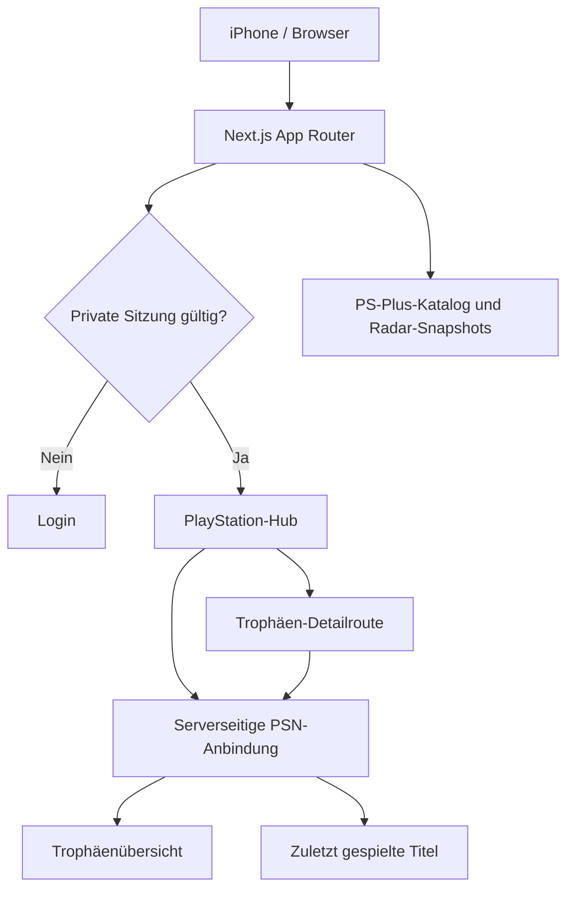

<div align="center">


# PlayStation Radar

**Dein privates Dashboard für PlayStation, PS Plus, Spielaktivität und Trophäen.**

[](https://nextjs.org/)
[](https://react.dev/)
[](https://vercel.com/)
[](#-sicherheit)
[](https://github.com/westside0106/Ps5-Radar/actions/workflows/daily-catalog.yml)

[**Dashboard**](#-funktionen) · [**PlayStation-Hub**](#-playstation-hub) · [**Installation**](#-lokal-starten) · [**Architektur**](#-architektur) · [**Roadmap**](#-roadmap)

</div>

> [!IMPORTANT]
> **Privates Projekt.** Das Repository enthält keinen PSN-Token. Die Live-Daten werden serverseitig aus geschützten Umgebungsvariablen geladen. Eine öffentliche Repository-README ist keine Zugriffssperre für die Anwendung.

## ✨ Funktionen

| Bereich | Funktion | Datenquelle |
|:--|:--|:--|
| **Radar** | PlayStation-Angebote und weitere Gaming-Informationen | Lokale Snapshots / Aktualisierungsworkflows |
| **PS Plus** | Katalog, Suche und Filter | Katalogdateien und Metadaten |
| **Mein PlayStation** | Trophäenlevel, Bronze/Silber/Gold/Platin | Persönliche PSN-Abfragen |
| **Trophäen-Zentrale** | Fortschrittsregler (0–100 %), Suche, Sortierung, Einzel-Trophäen auf Abruf | PSN Trophy API |
| **Meine Spielwelt** | Zuletzt gespielte Titel, Spielzeit (wenn verfügbar), Cover (wenn geliefert) | PSN Game List |
| **Private Anmeldung** | HTTP-only-Sitzungscookie | Next.js-Server |

## 🏆 PlayStation-Hub

Der geschützte Bereich **`/mein-playstation`** kombiniert zwei mobil optimierte Ansichten:

<table>
<tr><td width="50%" valign="top">

### Trophäen-Zentrale
- Mindestfortschritt per Slider von **0 bis 100 %**
- Schnellwahl: 0 / 25 / 50 / 75 / 90 %
- Suche und Sortierung
- Aufklappbare Trophäen je Spiel
- Freigeschaltete und offene Erfolge samt Typ und Datum, sofern von Sony geliefert

</td><td width="50%" valign="top">

### Meine Spielwelt
- Zuletzt gespielte Titel
- Cover-Karten, soweit die API Bilddaten liefert
- Spielzeit, sofern verfügbar
- Suche und Sortierung
- Responsive Grid für schmale Smartphone-Displays

</td></tr>
</table>

> [!NOTE]
> Die Spieleliste der PSN-Game-List ist **nicht automatisch eine vollständige Kaufbibliothek**. Sony-Endpunkte sind inoffiziell und können sich ändern. Einzel-Trophäen werden erst beim Öffnen einer Spielkarte abgerufen und serverseitig kurz zwischengespeichert.

## 🧱 Architektur



**Stack:** Next.js 16 · React 19 · JavaScript/JSX · CSS · Vercel · GitHub Actions.

## 🔐 Sicherheit

Konfiguriere die folgenden Variablen in Vercel unter **Environment Variables**:

| Variable | Zweck |
|:--|:--|
| `RADAR_PASSWORD` | Passwort für die private Anmeldung |
| `RADAR_SESSION_SECRET` | Langer zufälliger Sitzungsschlüssel (mindestens 32 Zeichen) |
| `PSN_NPSSO` | Optional: privater Sony-Session-Token für die PSN-Integration |

- **Niemals** Secrets in Dateien, Commits, Screenshots oder Issue-Logs veröffentlichen.
- Der PSN-Token bleibt ausschließlich auf dem Server; Browseranfragen an Detailrouten erfordern die Radar-Sitzung.
- Die Integration ist **read-only** und verwendet eine **inoffizielle** PSN-Schnittstelle.
- `robots`-Sperren verhindern keine unberechtigten Zugriffe; entscheidend ist die serverseitige Authentifizierung.

## 🚀 Lokal starten

```bash
git clone https://github.com/westside0106/Ps5-Radar.git
cd Ps5-Radar
cp .env.example .env.local
npm install
npm run dev
```

Öffne anschließend `http://localhost:3000`. Trage benötigte Variablen nur in `.env.local` ein und committe diese Datei nicht.

<details>
<summary><b>Weitere Befehle und Checks</b></summary>

```bash
npm run build
npm run test:goal
npm run test:platform
npm run catalog:refresh
```

Die Befehle sind im `package.json` definiert. Erfolgreiche Tests oder ein erfolgreiches Deployment werden hier nicht pauschal behauptet; der aktuelle Status ist in den GitHub Actions und bei Vercel zu prüfen.

</details>

## 📂 Projektstruktur

| Pfad | Zweck |
|:--|:--|
| `app/mein-playstation/` | Privates PSN-Hub, UI und geschützte Detailroute |
| `lib/psn-server.mjs` | Serverseitige PSN-Abfragen und Cache |
| `app/ps-plus/` | PS-Plus-Katalog |
| `app/radar/` | Radar-Ansicht |
| `data/` | Katalog- und Radar-Snapshots |
| `.github/workflows/` | Automatische Aktualisierungsworkflows |
| `scripts/` | Aktualisierung, Validierung und Tests |

## 🗺️ Roadmap

- [x] Private PSN-Verbindung und Trophäenübersicht
- [x] Interaktiver Fortschrittsfilter
- [x] Trophäen-Zentrale mit bedarfsgeladenen Detaildaten
- [x] Meine Spielwelt für zuletzt gespielte Titel
- [ ] Vollständigen PSN-Kaufbibliotheksabruf und Lizenzstatus gesondert verifizieren
- [ ] PS-Plus-Bibliotheksabgleich und persönliche Empfehlungen
- [ ] Trophäen-Seltenheit, zusätzliche Filter und verbesserte Bilddaten
- [ ] **Gaming-Jahresrückblick / PlayStation Wrapped** — vorgemerkt, keine Priorität
- [ ] **Xbox-Integration (nachrangig)** — erst nach Fertigstellung der PlayStation-Funktionen; Xbox-Spiele und Achievements optional ergänzen
- [ ] Automatisierte Integrationstests der Sony-Endpunkte ohne Veröffentlichung von Zugangsdaten

## ℹ️ Hinweise

Dieses private Fanprojekt ist **nicht mit Sony Interactive Entertainment verbunden**. PlayStation ist eine Marke der jeweiligen Rechteinhaber. API-Verfügbarkeit, Spielzeiten, Cover und Trophäendaten hängen von Sonys Schnittstellen und den Privatsphäre-Einstellungen ab.

<div align="center">


</div>
